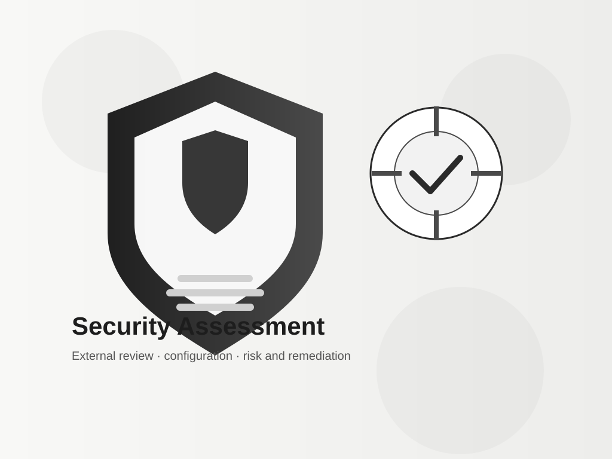

# Security Assessment Reports Repository

This repository contains a de-identified external security assessment of a publicly exposed web application and supporting infrastructure. The material has been anonymized to protect the target while preserving the substantive findings, limitations, and remediation recommendations.

The project is organized to keep the report readable, traceable, and suitable for professional review:

- `README.md` — repository overview and navigation
- `docs/security-assessment-report.md` — full assessment report
- `docs/appendix-methodology.md` — methodology, scope, and limitations
- `archive/original/README.original.md` — preserved original report content
- `assets/diagrams/architecture-overview.svg` — architecture diagram
- `assets/diagrams/risk-summary.svg` — risk summary diagram
- `assets/visuals/security-hero.svg` — open-source-style visual illustration
- `assets/visuals/security-shield.svg` — security symbol illustration

## Overview

This repository documents a focused external review of a target news portal with public-facing services. The assessment centers on configuration weaknesses, legacy software exposure, hardening gaps, and limited application-layer validation under a controlled, non-destructive testing model.

The report was refined to read like a professional security assessment rather than a generic template. It keeps the evidence intact while improving clarity, structure, and editorial quality.

## Executive Summary

The assessment identified several material concerns, especially in infrastructure and configuration hygiene rather than in the tested application-layer search functionality.

The most significant findings were:

- unsupported PHP runtime exposure (PHP 5.3.10);
- publicly accessible phpMyAdmin setup interface;
- support for deprecated TLS 1.0 and TLS 1.1 protocols;
- missing Secure and HttpOnly attributes on HTTP cookies;
- wildcard DNS behavior that caused arbitrary subdomains to resolve to the same infrastructure address.

No successful exploitation was observed in the tested XSS or SQL injection scenarios within the defined review scope. That said, the absence of observed exploitation does not prove that every application surface is free from weakness.

## Report Index

- [Full Security Assessment Report](docs/security-assessment-report.md)
- [Methodology and Scope Appendix](docs/appendix-methodology.md)
- [Original Preserved Report](archive/original/README.original.md)

## Visual Assets

The repository includes simple, original vector illustrations designed for professional documentation and internal review. They are intentionally minimal and do not rely on copyrighted stock imagery.

## Important Notes

This repository preserves the original evidence-based assessment while improving readability, consistency, and professional presentation. The conclusions remain conservative and do not claim that every possible vulnerability has been ruled out.

Where the available source material did not allow a definitive conclusion, the report notes the need for manual verification. This applies especially to package-level CVE applicability and the exact vendor patch state of the observed PHP runtime.

## Classification

Confidential — Security Assessment Documentation

## Intended Use

This repository is suitable for:

- internal review and stakeholder communication;
- professional documentation reference;
- security assessment and reporting practice;
- evidence preservation of a de-identified black-box assessment.

## Final Note

The content was revised to sound more human, precise, and professional without altering the underlying technical meaning. The repository is now structured for clearer reading and improved presentation.
